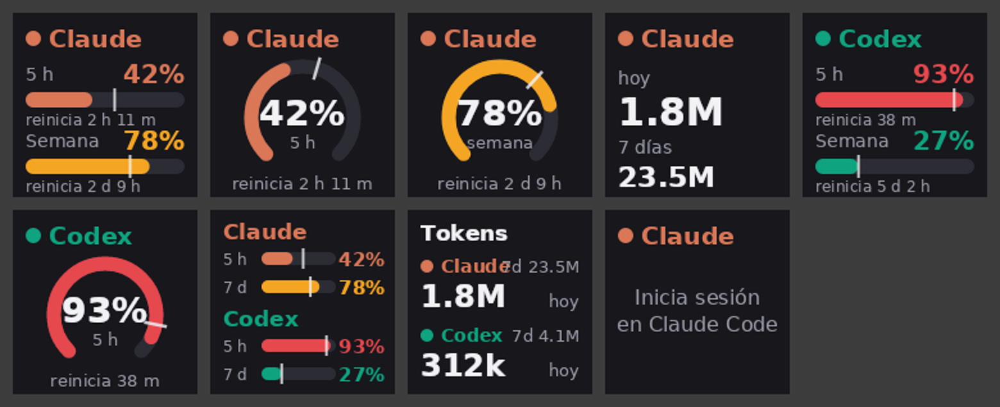

# TokenBars para Stream Dock (Ajazz / Mirabox)

Plugin para el software **Stream Dock** de Ajazz/Mirabox (AKP153, AKP03, AKP815, N3…)
que muestra en las teclas el uso de **Claude** y **Codex (ChatGPT)**: límite de 5 h,
límite semanal y tokens. Usa la misma lógica que el widget de la barra de tareas:
lee las credenciales de `~/.claude` y `~/.codex` (también dentro de WSL).



## Teclas

| Acción | Qué muestra | Al pulsar |
|---|---|---|
| **Claude** | Barras de 5 h y semana con % y cuándo se reinician | Cambia de vista: ambas → anillo 5 h → anillo semana → tokens |
| **Codex** | Lo mismo para Codex | Igual que Claude |
| **Claude + Codex** | Las cuatro barras en una tecla | Actualiza ya |
| **Tokens hoy** | Tokens de hoy y de 7 días de Claude Code y Codex CLI | Actualiza ya |

Colores: Claude naranja, Codex verde; la barra pasa a ámbar desde el 75 % y a rojo desde el 90 %.
La rayita blanca marca el ritmo: dónde estaría la barra si gastaras el límite de forma pareja
hasta el reinicio. Si la barra va por delante de la rayita, vas rápido.

Los datos se actualizan cada 90 s (y al pulsar una tecla). Los tokens salen de los registros
locales de Claude Code y Codex CLI en este PC; el uso desde la web solo se ve en las barras.

## Instalar

1. Descomprime el zip.
2. Doble clic en `install.cmd`. Cierra Stream Dock, copia el plugin a
   `%APPDATA%\HotSpot\StreamDock\plugins\` y vuelve a abrir Stream Dock.
3. En Stream Dock busca la categoría **TokenBars** y arrastra las acciones a las teclas.

Instalación manual: copia la carpeta `com.tokenbars.streamdock.sdPlugin` a
`%APPDATA%\HotSpot\StreamDock\plugins\` y reinicia Stream Dock.

Requisito: haber iniciado sesión al menos una vez con Claude Code (`claude`) y/o Codex CLI (`codex`).
Registro de errores: `%APPDATA%\TokenBars\streamdock.log`.

## Compilar

```
cd streamdock\TokenBars.StreamDock
dotnet publish -c Release -r win-x64 --self-contained -p:PublishSingleFile=true -p:IncludeNativeLibrariesForSelfExtract=true -p:EnableCompressionInSingleFile=true -o ..\com.tokenbars.streamdock.sdPlugin\bin
```

`TokenBarsDock.exe --preview <carpeta>` dibuja teclas de ejemplo en PNG sin necesidad de Stream Dock,
y `--preview-live <carpeta>` hace lo mismo con tus datos reales.
